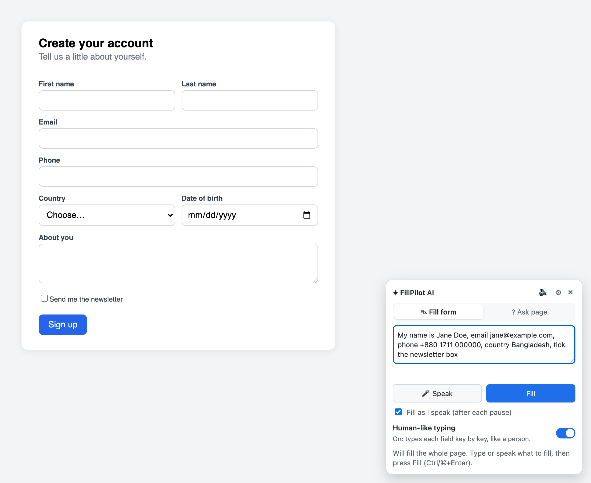
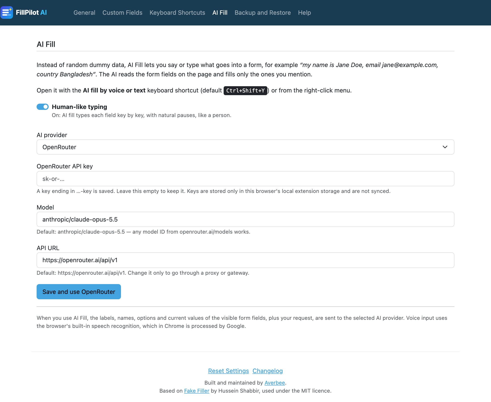
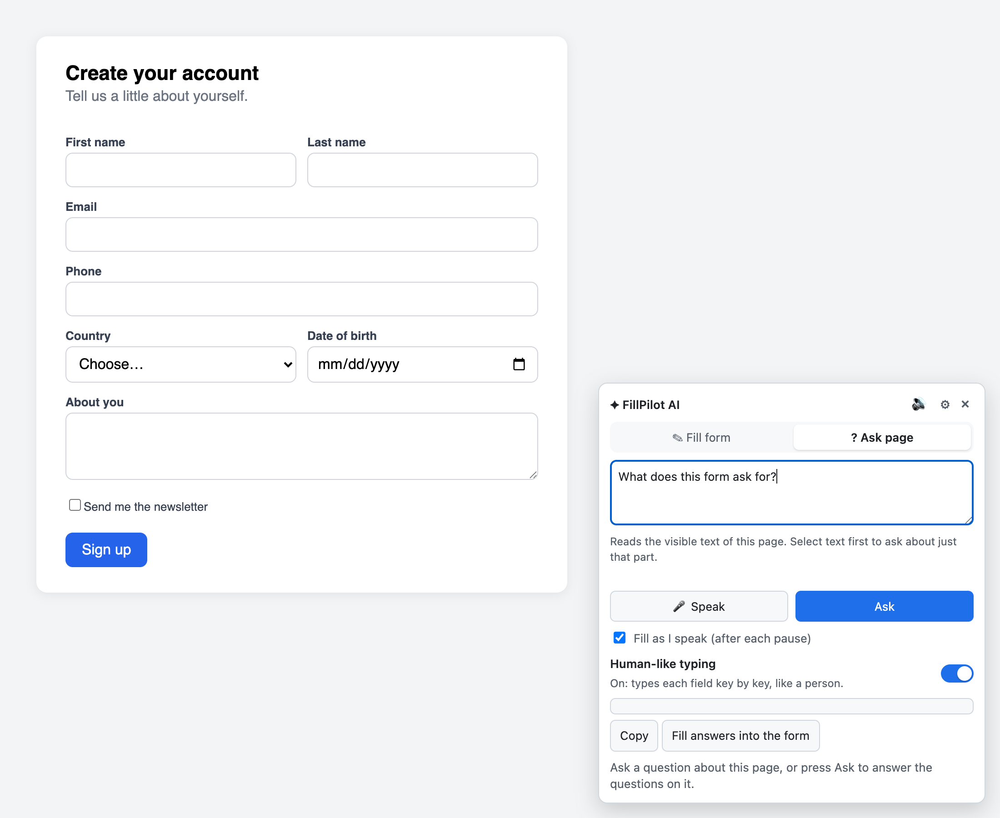
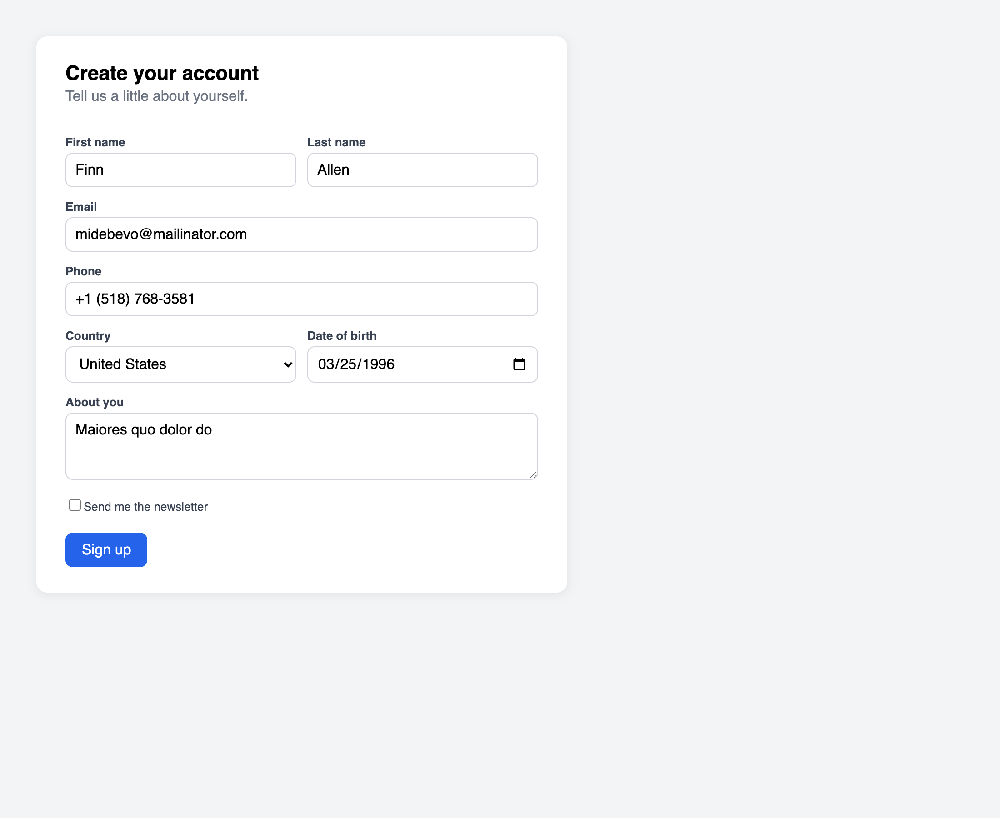
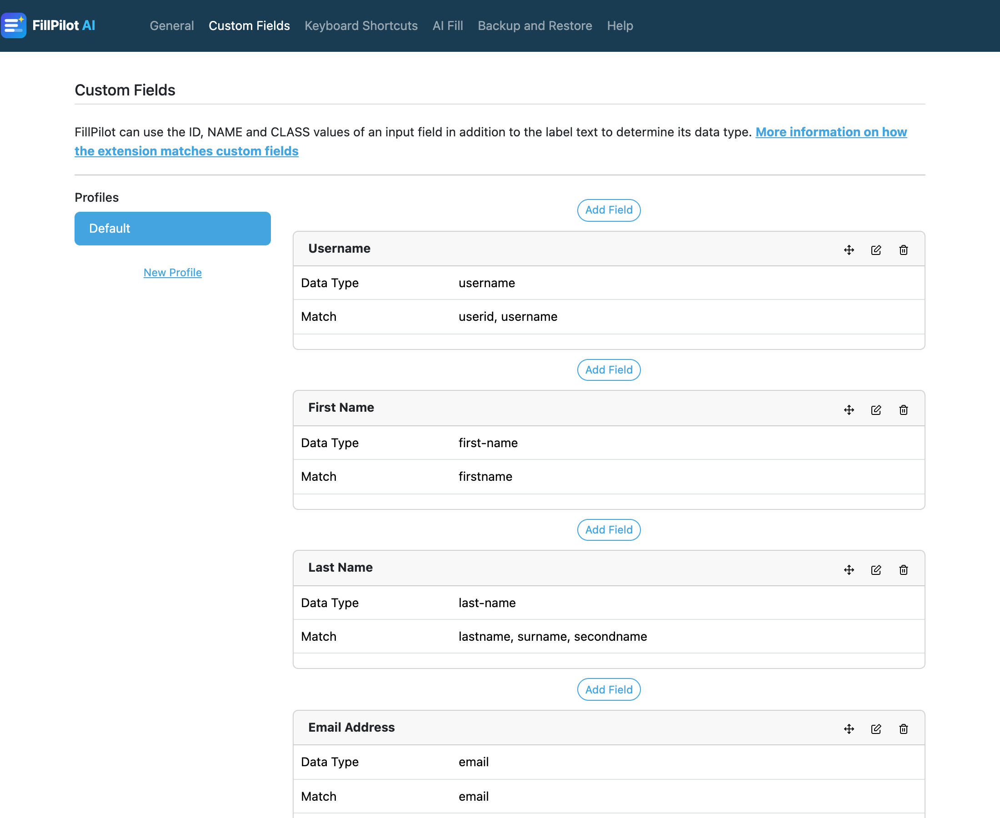

#  FillPilot AI

A browser extension for Chrome, Edge and Firefox that fills web forms for you.

Built and maintained by [Averbee](https://averbee.com/).

- **AI fill.** Press <kbd>Ctrl+Shift+Y</kbd>, then say or type what goes in the form ("my name is Jane Doe, email jane@example.com, country Bangladesh"). The AI reads the fields on the page and fills only the ones you mention. It can type the way a person does, and it handles text fields, dropdowns, checkboxes, radio groups, switches and custom ARIA widgets.
- **Ask page.** In the panel's *Ask page* tab (or right-click → *Ask AI about this page…*), ask a question about the page, or leave it empty to have the AI answer the questions it finds on the page. Select text first to ask about just that part. Answers can be copied or filled straight into the form.
- **Human-like typing switch.** On: AI fill types each field key by key, like a person. Off: it fills instantly. The switch is in the panel and on the options page.
- **Dummy data in one click.** Click the toolbar icon or press <kbd>Ctrl+Shift+F</kbd> to fill every input with realistic fake data. Custom fields and URL-specific profiles control what goes where.
- **Audio transcriber.** Writes down the speech playing in a tab or on your computer, using the 🔊 icon in the AI fill panel or the right-click menu.
- **Your choice of AI.** OpenRouter, Claude, or any OpenAI-compatible API URL (OpenAI, Groq, Together, Ollama, LM Studio…). API keys stay in the browser's local storage and are never synced.
- **Sync.** Settings follow you through your browser account (Google, Microsoft or Firefox).



## How to use

### 1. Add your AI key

Open the extension's options page (right-click the toolbar icon → **Options**) and go to the **AI Fill** tab. Pick a provider, paste your API key, check the model and choose **Save**. You can also enter the key in the panel itself the first time you open it.

The key is kept only in this browser's local extension storage and is never synced.



### 2. Fill a form with AI

1. Open a page with a form.
2. Press <kbd>Ctrl+Shift+Y</kbd> (<kbd>⌘+Shift+Y</kbd> on Mac), or right-click the page and choose **AI fill by voice or text…**. The FillPilot AI panel opens in the bottom-right corner.
3. In the **Fill form** tab, type what goes in the form, for example *"My name is Jane Doe, email jane@example.com, country Bangladesh, tick the newsletter box"*. Or choose **🎤 Speak** and say it.
4. Choose **Fill** (or press <kbd>Ctrl+Enter</kbd>). The AI fills only the fields you mentioned.

Turn **Human-like typing** on to have each field typed key by key, or off to fill instantly. With **Fill as I speak** ticked, the form fills after each pause in your speech.

### 3. Ask about a page

Switch to the **? Ask page** tab (or right-click → **Ask AI about this page…**). Type a question and choose **Ask**, or leave the box empty and the AI answers the questions it finds on the page. To ask about one part only, select that text first. Use **Copy** to copy the answer, or **Fill answers into the form** to put the answers straight into the page's fields.



### 4. Fill everything with dummy data

Click the FillPilot toolbar icon, or press <kbd>Ctrl+Shift+F</kbd>, and every input on the page gets realistic fake data: names, emails, phone numbers, dates, dropdowns and checkboxes. No AI key is needed. Right-click a form or a single field to fill just that form or field.



### 5. Control what dummy data goes where

The **Custom Fields** tab on the options page lists rules that match fields by their ID, name, class or label and choose the kind of data for each. Add, edit, reorder or delete rules, and create **profiles** so a site can use its own set of rules.



### 6. Transcribe audio

Choose the 🔊 icon in the AI fill panel, or right-click → **Transcribe audio that is playing…**, then share a tab or your screen with audio. FillPilot writes down the speech that plays (Chrome and Edge only).

### Keyboard shortcuts

| Shortcut | Action |
| --- | --- |
| <kbd>Ctrl+Shift+Y</kbd> | Open the AI fill panel |
| <kbd>Ctrl+Shift+F</kbd> | Fill all inputs with dummy data |

*Fill this form*, *Fill this input field*, *Ask AI about this page* and *Transcribe audio* have no shortcut by default. Set them at `chrome://extensions/shortcuts` (Chrome), `edge://extensions/shortcuts` (Edge) or `about:addons` → ⚙ → **Manage Extension Shortcuts** (Firefox).

## Build

Requires Node.js 22.22 or later.

```sh
npm install
npm run build
```

One build produces all three browsers:

| Browser | Folder to load | Store upload |
| --- | --- | --- |
| Chrome (110+) | `dist/chrome` | `dist/fillpilot-chrome-<version>.zip` |
| Edge (110+) | `dist/edge` | `dist/fillpilot-edge-<version>.zip` |
| Firefox (128+) | `dist/firefox` | `dist/fillpilot-firefox-<version>.zip` |

To load a build for development:

- **Chrome / Edge:** open `chrome://extensions` or `edge://extensions`, turn on Developer mode, choose **Load unpacked** and pick the folder.
- **Firefox:** open `about:debugging#/runtime/this-firefox`, choose **Load Temporary Add-on** and pick `dist/firefox/manifest.json`. Firefox treats host access as optional in Manifest V3, so allow the extension to access websites in `about:addons` → FillPilot AI → Permissions.

Other scripts: `npm run watch` (rebuilds dist/chrome on change), `npm run build-dev` (unminified, with source maps), `npm run typecheck`, `npm run lint`.

## Browser differences

- Voice input uses the browser's speech recognition, which Chrome and Edge provide and Firefox does not. Typing still works everywhere.
- The audio transcriber needs Chrome's or Edge's tab and system audio sharing. Firefox's screen sharing does not include audio.

## Credits

FillPilot AI is developed by [Averbee](https://averbee.com/), which added the AI fill, Ask page, audio transcriber, multi-provider AI support and the Chrome, Edge and Firefox builds.

Based on [Fake Filler](https://github.com/FakeFiller/fake-filler-extension) by Hussein Shabbir, used under the MIT licence (see `LICENSE`).
